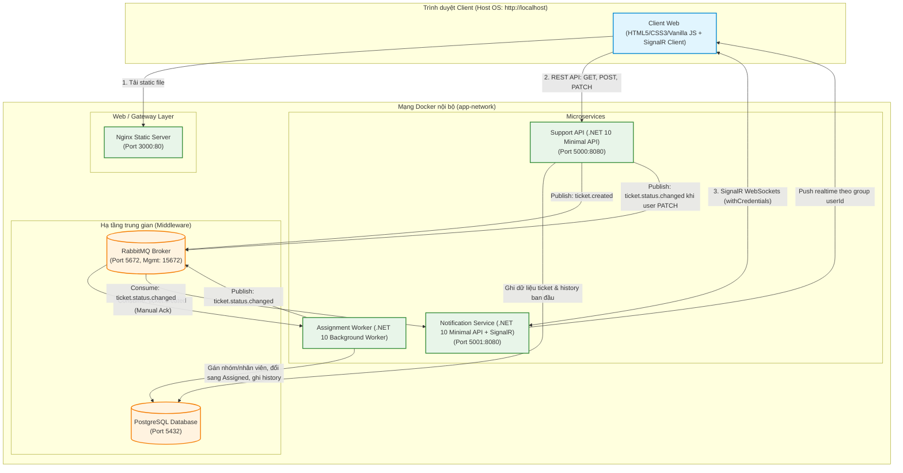
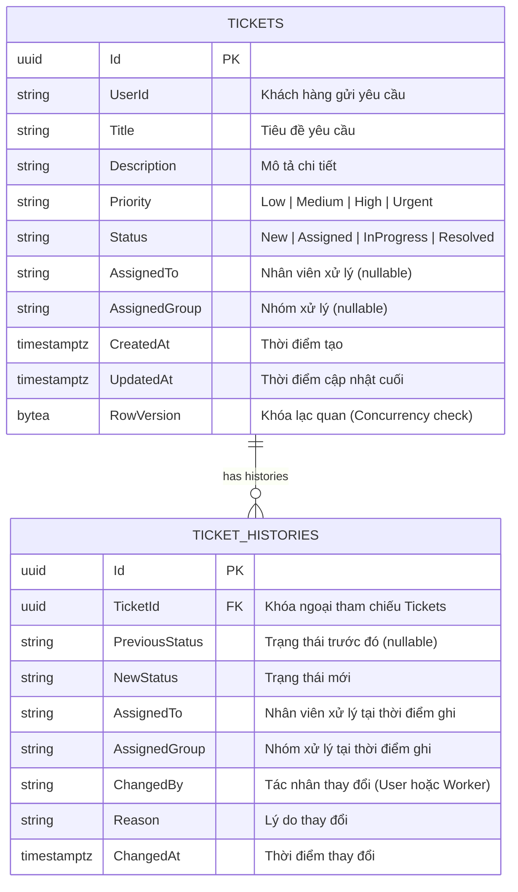
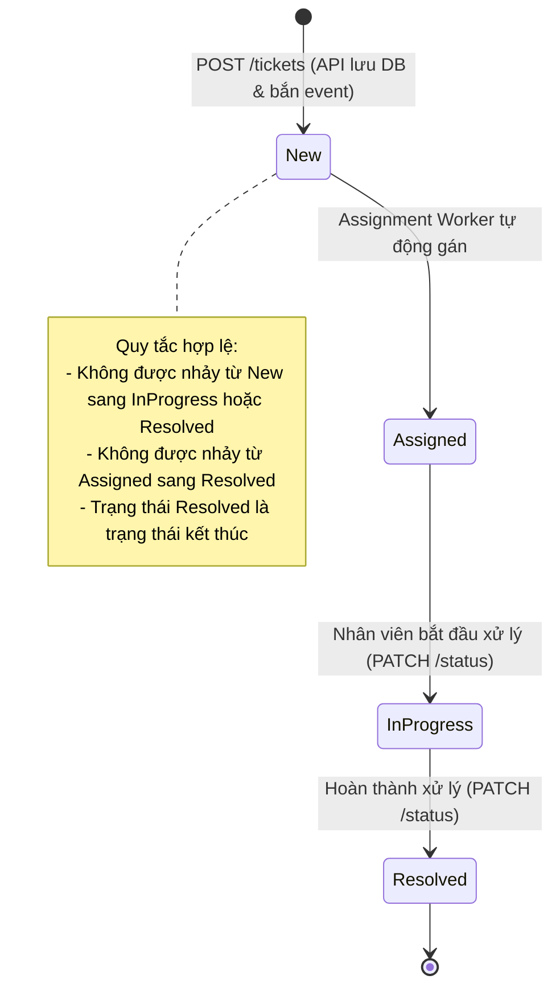
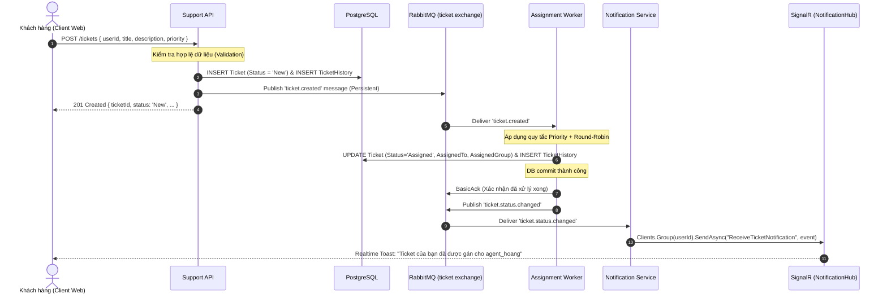
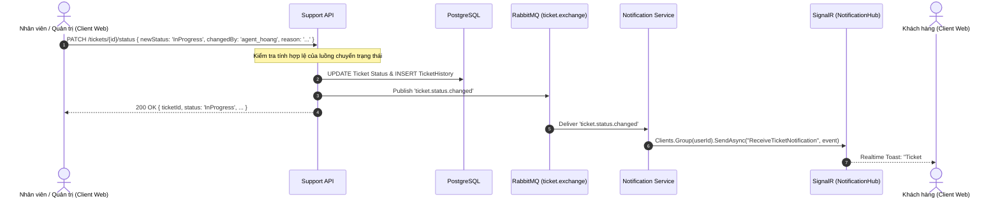

# TÀI LIỆU THIẾT KẾ HỆ THỐNG HỖ TRỢ YÊU CẦU KHÁCH HÀNG
**Học phần:** Phát triển ứng dụng phân tán  
**Đề tài 07:** Hệ thống hỗ trợ yêu cầu khách hàng  
**Nền tảng:** .NET 10, ASP.NET Core Minimal API, RabbitMQ, SignalR, PostgreSQL, Docker Compose  

---

## 1. BẢNG TRUY VẾT YÊU CẦU (TRACEABILITY MATRIX)

| STT | Chức năng / Yêu cầu đề tài | Thành phần đảm nhiệm | Giao thức / Cơ chế |
|:---|:---|:---|:---|
| 1 | Tạo yêu cầu hỗ trợ mới | **Support API** (`POST /tickets`), **Client Web** (Form tạo) | HTTP POST / REST |
| 2 | Tra cứu danh sách và chi tiết yêu cầu | **Support API** (`GET /tickets`, `GET /tickets/{id}`, `GET /users/{userId}/tickets`), **Client Web** | HTTP GET / REST |
| 3 | Đưa yêu cầu mới vào queue phân loại | **Support API** (Publisher) -> **RabbitMQ** (`ticket.exchange`) | AMQP (Durable Queue, Persistent Message) |
| 4 | Worker gán nhóm/nhân viên theo quy tắc | **Assignment Worker** (Consumer) | AMQP Manual Ack, Priority + Round-Robin Rule |
| 5 | Cập nhật trạng thái hợp lệ (New -> Assigned -> InProgress -> Resolved) | **Support API** (`PATCH /tickets/{id}/status`), **Assignment Worker** (New -> Assigned) | State Machine Validation (EF Core -> PostgreSQL) |
| 6 | Phát sự kiện khi trạng thái/người xử lý thay đổi | **Support API** & **Assignment Worker** -> **RabbitMQ** | Event Publishing (`ticket.status.changed`) |
| 7 | Gửi thông báo realtime cho client liên quan | **Notification Service** (RabbitMQ Consumer -> SignalR Hub) -> **Client Web** (SignalR JS) | WebSockets / SSE qua SignalR Hub (theo Group `userId`) |
| 8 | Lưu lịch sử thay đổi của yêu cầu | **PostgreSQL** (`TicketHistories`), **Support API**, **Assignment Worker** | EF Core DbContext Transaction |

---

## 2. KIẾN TRÚC HỆ THỐNG TỔNG THỂ



---

## 3. THIẾT KẾ MESSAGE VÀ SỰ KIỆN (RABBITMQ)

### 3.1. Topology RabbitMQ
- **Exchange Name:** `ticket.exchange`
- **Exchange Type:** `topic`
- **Tính bền vững:** `durable = true`

| Queue Name | Routing Key Binding | Mục đích | Consumer | Cấu hình độ bền |
|:---|:---|:---|:---|:---|
| `ticket.creation.queue` | `ticket.created` | Hàng đợi tiếp nhận ticket mới để phân công | **Assignment Worker** | `durable = true`, Dead-letter sẵn sàng |
| `ticket.notification.queue` | `ticket.status.changed` | Hàng đợi tiếp nhận sự kiện đổi trạng thái/phân công để phát thông báo | **Notification Service** | `durable = true` |

### 3.2. Cấu trúc Message Payload (Contracts)

#### a) `TicketCreatedEvent` (routing key: `ticket.created`)
```json
{
  "eventId": "b6a8df80-a614-4dc4-8da0-cf8a0026e632",
  "ticketId": "6c2017fc-ff6b-4e1b-b467-f3165b4033b0",
  "userId": "customer_01",
  "title": "Không thể thanh toán đơn hàng",
  "description": "Lỗi 500 khi nhấn nút thanh toán tại bước kiểm tra thẻ tín dụng",
  "priority": "Urgent",
  "createdAt": "2026-11-13T10:30:00Z",
  "correlationId": "corr-1731493800-001"
}
```

#### b) `TicketStatusChangedEvent` (routing key: `ticket.status.changed`)
```json
{
  "eventId": "f781a7b4-3652-45e0-94a2-15f77864ce1a",
  "ticketId": "6c2017fc-ff6b-4e1b-b467-f3165b4033b0",
  "userId": "customer_01",
  "oldStatus": "New",
  "newStatus": "Assigned",
  "assignedTo": "agent_hoang",
  "assignedGroup": "L3_Critical_Support",
  "reason": "Tự động phân công theo quy tắc Priority + Round-Robin",
  "changedBy": "AssignmentWorker",
  "changedAt": "2026-11-13T10:30:02Z",
  "correlationId": "corr-1731493800-001"
}
```

---

## 4. THIẾT KẾ CƠ SỞ DỮ LIỆU (POSTGRESQL)



---

## 5. MÔ HÌNH CHUYỂN TRẠNG THÁI (STATE MACHINE)



---

## 6. QUY TẮC PHÂN CÔNG CỦA ASSIGNMENT WORKER

Để hệ thống hoạt động ổn định, dự đoán được và dễ bảo vệ trước hội đồng chấm thi, Worker áp dụng quy tắc kết hợp: **Ưu tiên (Priority-based) + Cân bằng tải vòng tròn (Round-Robin)**:

1. **Phân nhóm theo mức độ ưu tiên (`Priority`)**:
   - `Urgent`: Nhóm `L3_Critical_Support` (đội ngũ giải quyết sự cố khẩn cấp).
   - `High`: Nhóm `L2_Senior_Support` (chuyên viên cao cấp).
   - `Medium` & `Low`: Nhóm `L1_Helpdesk_Support` (bộ phận tiếp nhận & giải đáp cơ bản).

2. **Gán nhân viên trong nhóm theo thuật toán Round-Robin**:
   - Nhóm `L3_Critical_Support`: `agent_hoang`, `agent_dung`
   - Nhóm `L2_Senior_Support`: `agent_lan`, `agent_minh`
   - Nhóm `L1_Helpdesk_Support`: `agent_an`, `agent_binh`, `agent_chi`

3. **Luồng thực thi trong Worker**:
   - Nhận message `TicketCreatedEvent` từ `ticket.creation.queue`.
   - Tính toán `assignedGroup` và `assignedTo` theo thuật toán trên.
   - Mở Transaction cập nhật vào PostgreSQL:
     - Đổi trạng thái ticket từ `New` sang `Assigned`.
     - Điền `AssignedTo` và `AssignedGroup`.
     - Thêm 1 bản ghi vào bảng `TicketHistories`.
   - Chỉ khi DB commit thành công, gọi `channel.BasicAck`.
   - Publish sự kiện `TicketStatusChangedEvent` vào exchange `ticket.exchange` (routing key `ticket.status.changed`).

---

## 7. CÁC BIỂU ĐỒ TRÌNH TỰ (SEQUENCE DIAGRAMS)

### 7.1. Trình tự Tạo Ticket & Tự động Phân công



### 7.2. Trình tự Cập nhật Trạng thái (PATCH /tickets/{id}/status)



---

## 8. DANH SÁCH API ENDPOINTS (SUPPORT API)

1. `POST /tickets`
   - Body: `{ "userId": "string", "title": "string", "description": "string", "priority": "Low|Medium|High|Urgent" }`
   - Response: `201 Created`
2. `GET /tickets`
   - Query: `?status=...&priority=...&page=1&pageSize=20`
   - Response: `200 OK [ { ticket... }, ... ]`
3. `GET /tickets/{id}`
   - Path: `id` (GUID)
   - Response: `200 OK { ticket, histories: [ ... ] }` hoặc `404 Not Found`
4. `PATCH /tickets/{id}/status`
   - Path: `id` (GUID)
   - Body: `{ "newStatus": "Assigned|InProgress|Resolved", "changedBy": "string", "reason": "string" }`
   - Response: `200 OK` hoặc `400 Bad Request` (nếu sai luồng trạng thái)
5. `GET /users/{userId}/tickets`
   - Path: `userId` (string)
   - Response: `200 OK [ { ticket... }, ... ]`

---

## 9. THIẾT KẾ TỔ CHỨC DỰ ÁN (SOLUTION STRUCTURE)

```text
/
├── docs/
│   ├── design.md                      # Tài liệu phân tích và thiết kế hệ thống
│   ├── test-report.md                 # Báo cáo kết quả kiểm thử và khả năng chịu lỗi
│   └── defense-qa.md                  # 20+ câu hỏi & trả lời bảo vệ đồ án
├── src/
│   ├── DistributedTicketSystem.sln    # Solution tổng .NET 10
│   ├── Contracts/                     # Class thư viện chứa Message & Event dùng chung
│   │   └── DistributedTicketSystem.Contracts.csproj
│   ├── SupportApi/                    # ASP.NET Core Minimal API
│   │   ├── DistributedTicketSystem.SupportApi.csproj
│   │   └── Dockerfile
│   ├── AssignmentWorker/              # Background Worker Service
│   │   ├── DistributedTicketSystem.AssignmentWorker.csproj
│   │   └── Dockerfile
│   ├── NotificationService/           # ASP.NET Core Minimal API + SignalR Hub
│   │   ├── DistributedTicketSystem.NotificationService.csproj
│   │   └── Dockerfile
│   └── Client/                        # Web App tĩnh (HTML5, CSS3, Vanilla JS, Nginx)
│       ├── index.html
│       ├── style.css
│       ├── app.js
│       ├── config.js
│       ├── nginx.conf
│       └── Dockerfile
├── docker-compose.yml                 # Khởi chạy toàn bộ hệ thống bằng 1 lệnh duy nhất
├── .env.example                       # Mẫu biến môi trường cấu hình cổng, connection strings
├── .gitignore                         # Chuẩn .NET, IDE, temporary files
├── .editorconfig                      # Quy ước code style C#
└── README.md                          # Hướng dẫn chi tiết thiết lập, khởi chạy và demo
```
